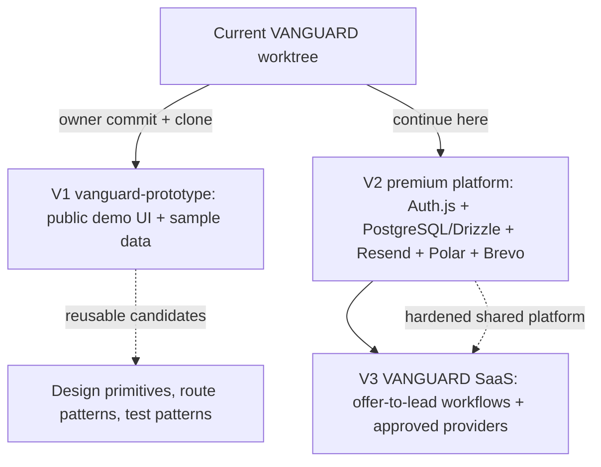

# VANGUARD V1 checkpoint report

**Date:** 2026-11-25  
**Checkpoint requested:** V1 — Free SaaS Starter / Prototype  
**Readiness signal:** **V1 public prototype is ready for your review, commit, and clone.** This is a prototype checkpoint only; it is not production readiness.

## Initial repository state

- Branch `audit/vanguard-platform-baseline`, HEAD `1b422ac` (`feat: add VANGUARD dashboard and landing experience`), tracking `origin/audit/vanguard-platform-baseline`.
- One `origin` remote; no tags at inspection.
- The worktree was already dirty before this checkpoint. Existing schema/migration, UI, config, test, marketing, font, and untracked work was preserved. No reset/clean was run.
- No commit, tag, clone, push, or deployment was created. The owner plans those steps after this readiness signal.

## Verified architecture

- Next.js 16.4.6 App Router, React 19.3.0, TypeScript, Tailwind CSS 4.3.3, PostgreSQL, and Drizzle ORM.
- V1's public route group renders `AppShell`, `PrototypeProvider`, mock adapter data, and client-side preview interactions. It does not query the database or require an account/provider credential.
- V2 groundwork remains in source: Auth.js code/actions, PostgreSQL/Drizzle schema and migrations, tenant membership/RLS helpers, and Resend transactional sender. V1 no longer exposes the Auth.js API route or account/onboarding forms.
- VANGUARD-specific product screens (offer analysis, qualification, prospects, campaigns, reports, agents) are UI/demo state rather than a live business engine.

## Work completed for V1

- Made the marketing-to-app journey public and removed the session gate from product routes. Account, password, verification, and onboarding URLs direct users to the prototype.
- Added a persistent notice that sample data and simulated actions are not live accounts, email, payment, or provider features.
- Replaced account-backed profile, organization, team, and security routes with illustrative screens; updated the sample identity to Alex Morgan and an `.example` address.
- Changed invitation feedback to say no email was sent; changed plan selection to a preview-only action and removed unapproved sample prices.
- Clarified the security page and offline fallback for the public V1 context.
- Updated README/development instructions so running V1 does not require PostgreSQL, Docker, or provider credentials.
- Added repository, architecture, security, production-readiness, and extraction documents under `docs/audit/`.

## V1 validation results

| Check                                      | Result                        | Evidence                                                                                                                                                                                                             |
| ------------------------------------------ | ----------------------------- | -------------------------------------------------------------------------------------------------------------------------------------------------------------------------------------------------------------------- |
| Next.js route type generation + TypeScript | PASS                          | `next typegen`; `tsc --noEmit`                                                                                                                                                                                       |
| ESLint                                     | PASS                          | `eslint .`                                                                                                                                                                                                           |
| Vitest unit + database integration         | PASS                          | 4 files, 11 tests passed using configured local DB environment; DB suite is skipped without its URLs                                                                                                                 |
| Production build                           | PASS                          | `next build`; public routes generated, including product routes and account redirects                                                                                                                                |
| Browser E2E                                | PASS                          | 30/30 tests, including public route journeys, legal draft labels, keyboard interactions, mobile overflow, and desktop/tablet/phone layouts                                                                           |
| PWA assertions                             | PASS, runner teardown BLOCKED | Both service-worker/offline assertions printed as passed. Playwright remained open after reporting results and was manually stopped; clean process exit was not observed.                                            |
| Prettier check                             | FAIL                          | `prettier --check .` reports 53 repository files unformatted. No repo-wide formatting sweep was applied because the worktree contains pre-existing user changes and such a sweep would create broad unrelated diffs. |
| Live email/payment/newsletter transactions | NOT RUN                       | Credentials and provider accounts are not part of V1; no live transaction was claimed.                                                                                                                               |

## Provider and product status

| Area             | Status at V1 checkpoint                                                                                                                                                                             |
| ---------------- | --------------------------------------------------------------------------------------------------------------------------------------------------------------------------------------------------- |
| Resend           | REST sender and auth email actions remain as V2 source groundwork. V1 does not expose them. This checkout has no usable Resend key/sender configured; no delivery was tested.                       |
| Polar            | NOT IMPLEMENTED; deferred to V2/V3.                                                                                                                                                                 |
| Brevo            | NOT IMPLEMENTED; deferred to V2/V3.                                                                                                                                                                 |
| V1 prototype     | Public, unauthenticated, illustrative preview; ready for checkpoint review/clone.                                                                                                                   |
| V2 boilerplate   | NOT EXTRACTED. Auth/database/Resend groundwork is not a verified commercial boilerplate. Polar, Brevo, billing, newsletter consent, webhook and production setup remain.                            |
| V3 VANGUARD SaaS | NOT COMPLETE. Business-specific workflows currently use demo records/client state; no live discovery source, durable qualification engine, AI job system, billing, or outreach sender is connected. |

## Security, legal, and operational notes

- Public access is intentional only because V1 contains sample records and no private customer account data. It is not safe to use these open routes as customer tenancy boundaries.
- Tenant isolation/RLS integration tests passed against the local configured database. Those tests cover the current tested operations, not every future route or production deployment.
- Legal/trust pages contain placeholders and are drafts, not publication-ready legal documents or compliance claims.
- No live Resend configuration, Polar/Brevo setup, production deployment, monitoring, backups/recovery evidence, or CI workflow was verified.
- The full audit and limitations are documented in [PROJECT_AUDIT.md](audit/PROJECT_AUDIT.md), [ARCHITECTURE_MAP.md](audit/ARCHITECTURE_MAP.md), [SECURITY_AUDIT.md](audit/SECURITY_AUDIT.md), [PRODUCTION_READINESS.md](audit/PRODUCTION_READINESS.md), and [EXTRACTION_PLAN.md](audit/EXTRACTION_PLAN.md).

## Git checkpoints and repositories

- V1 commit ID: **not created**.
- V1 tag: **not created**.
- `vanguard-prototype` clone: **not created**.
- V2 and V3 repositories/checkpoints: **not created**.

The current worktree is ready for your diff review and the commit/clone step you said you will perform. `docs/audit/EXTRACTION_PLAN.md` records the owner-directed sequence and boundaries. After cloning V1, continue V2 work in this original repository.

## Architecture relationship

## Final signal

**V1 is ready for your commit and clone as an unauthenticated prototype.** Review the dirty worktree before committing because it includes pre-existing changes and untracked files. The format check and PWA runner teardown limitation above remain visible; neither indicates a failing product route or production feature, but they are recorded rather than hidden. V2 authentication, email delivery, payment, and newsletter integrations are intentionally not claimed as completed by this V1 signal.
