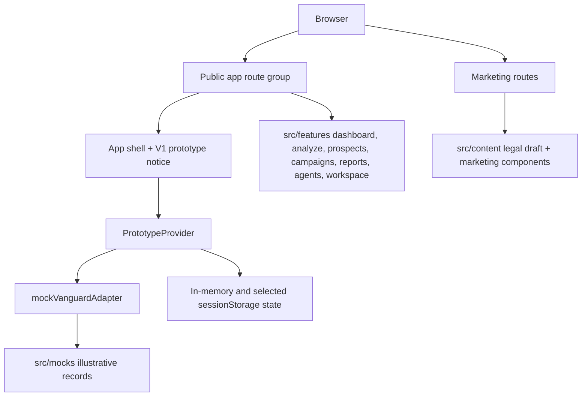
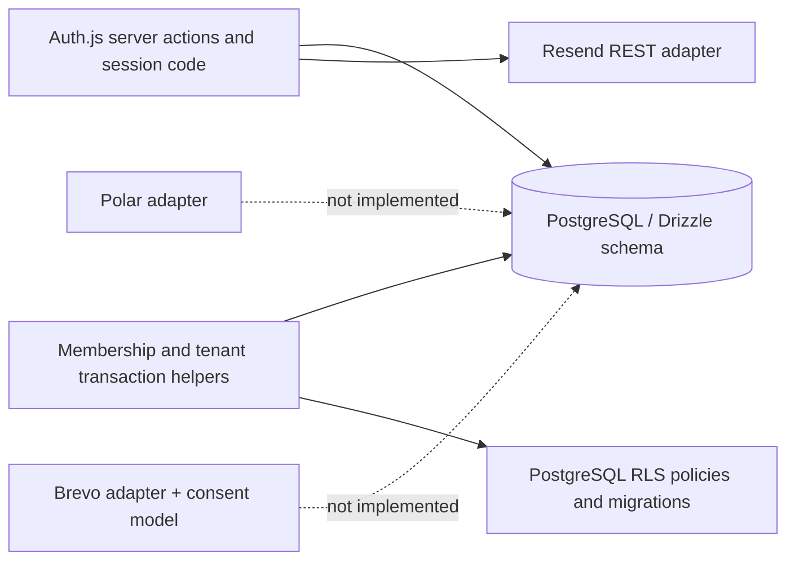

# VANGUARD architecture map

## Current V1 request and state flow

The V1 route group has no authentication gate and does not query PostgreSQL. Application screens are available directly; account and onboarding paths redirect to `/dashboard`. Demo interactions update client state and do not create server records or send external requests.

## V2 source groundwork currently retained in the worktree

Auth.js, account actions, tenant helpers, schema, migration files, and a Resend REST sender are present in source, but the V1 request tree does not expose the Auth.js API route or mount sign-in/onboarding forms. Environment configuration is not suitable for a live V2 email/auth flow. Treat this source as groundwork requiring a separate V2 audit and integration test cycle.

## Responsibility map

| Layer                 | Current location                                            | V1 status                                 | Intended later use                                                    |
| --------------------- | ----------------------------------------------------------- | ----------------------------------------- | --------------------------------------------------------------------- |
| Routes and layouts    | `src/app`                                                   | Public prototype routing                  | Shared App Router organization; V2 may add auth group/layouts         |
| Reusable UI           | `src/components/ui`, `src/components/layout`                | Active                                    | Shared candidate after decoupling VANGUARD labels                     |
| Marketing             | `src/components/marketing`, `src/app/marketing.css`         | Active, illustrative copy                 | VANGUARD product and possible starter reference                       |
| Product modules       | `src/features/*`                                            | Local-state UI                            | VANGUARD V3; not generic core                                         |
| Mock/demo data        | `src/mocks`, `src/lib/data-access/mock-adapter.ts`          | Active                                    | Keep in V1/V3 demos; exclude customer data from generic boilerplate   |
| Prototype state       | `src/store/prototype-context.tsx`                           | Active client context                     | V1 only unless replaced by server-backed modules                      |
| Auth and email source | `src/auth.ts`, `src/server/auth`, `src/app/actions/auth.ts` | Not mounted in V1 routes                  | V2 candidate; validate settings, credentials, and delivery before use |
| Database              | `src/server/db`, `drizzle/`, `docker/`                      | Unused by V1 app routes; used by DB tests | V2/V3 platform foundation                                             |
| Billing/newsletter    | no provider module found                                    | Not connected                             | Polar/Brevo V2/V3 modules                                             |

## Async processing and external effects

No job worker or scheduler was found. V1 analysis, agent, campaign, and plan interactions are illustrative browser actions. No provider webhook route or live campaign-send route is present. Resend calls exist in the V2 auth action code but require server-only provider configuration and are not part of V1's user journey.
