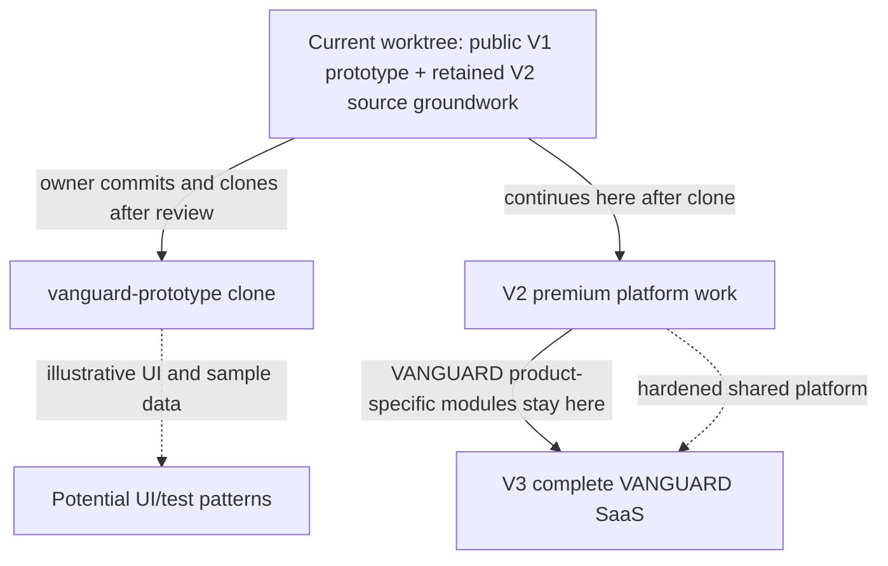

# Version extraction and checkpoint plan

## Owner-directed sequence

The owner clarified that the current checkpoint is an unauthenticated V1 prototype. The owner will commit and clone after receiving the V1-ready signal, then continue premium V2 work in this original repository. Accordingly, this audit did not commit, tag, clone, create a directory, or change remotes.

## V1 checkpoint contents

The current worktree presents the marketing site and full illustrative app shell without account setup. It also retains source-level PostgreSQL/Drizzle, Auth.js, Resend, and tenant-security groundwork from earlier work; those systems are not exposed as V1 account journeys. Before later distributing `vanguard-prototype`, a separate cleanup pass can remove dormant server foundation if a presentation-only clone is desired. Keep the original working copy for V2 work.

Suggested owner-controlled sequence after reviewing `git status` and the diff:

```powershell
git status --short --branch
git diff --check
git add -A
git commit -m "feat: establish public V1 prototype checkpoint"
git tag v1-prototype
git clone --branch v1-prototype --single-branch <local-repository-path> vanguard-prototype
```

Choose a tag name not already present; this audit observed no tags. Replace `<local-repository-path>` with the actual local source path. If cloning from the existing local repository, use its absolute path. Run `pnpm install`, `pnpm typecheck`, `pnpm lint`, `pnpm test`, `pnpm test:e2e`, and `pnpm build` inside the clone. Do not report the clone as established until those commands pass there.

## V2 and V3 boundaries

- **V2 premium boilerplate:** only after the V1 clone is established, turn on and independently validate Auth.js, PostgreSQL/Drizzle tenant infrastructure, Resend, Polar, Brevo, billing entitlements, and reusable setup docs. Exclude VANGUARD business-specific lead workflows from its reusable core.
- **V3 complete VANGUARD:** retain offer-to-lead intelligence, licensed discovery, explainable evidence, prospect review, campaign preparation, human approval, reports, and agent workflows in the original product. Connect real providers only after rights, credentials, and consent controls are verified.
- **Shared candidates:** UI primitives, design system, route conventions, database/auth/email modules after hardening, and test patterns. A shared candidate is not yet an extracted module.

## Current checkpoint relationship



No independent repository, commit identifier, or tag exists yet for the V1 clone.
